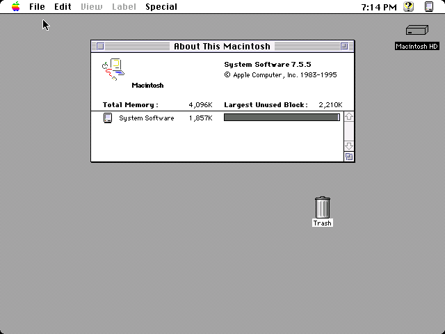
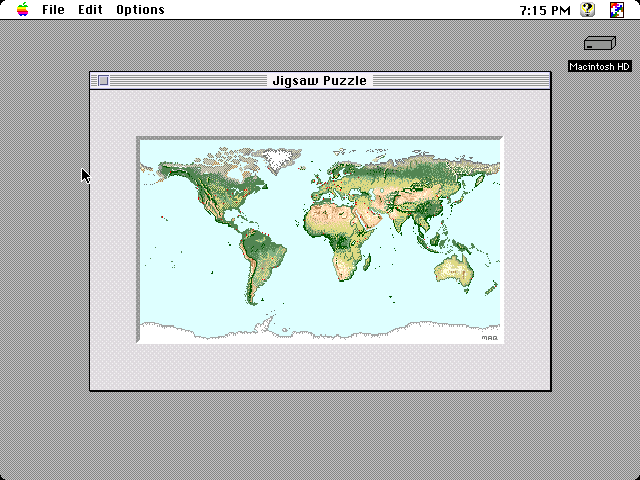
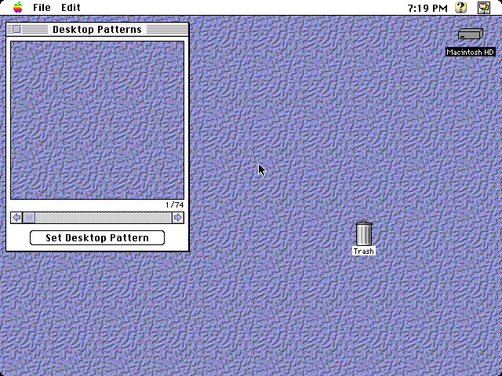
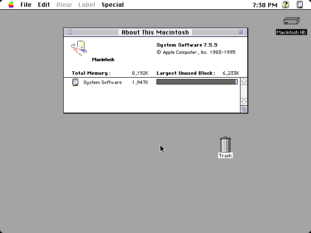
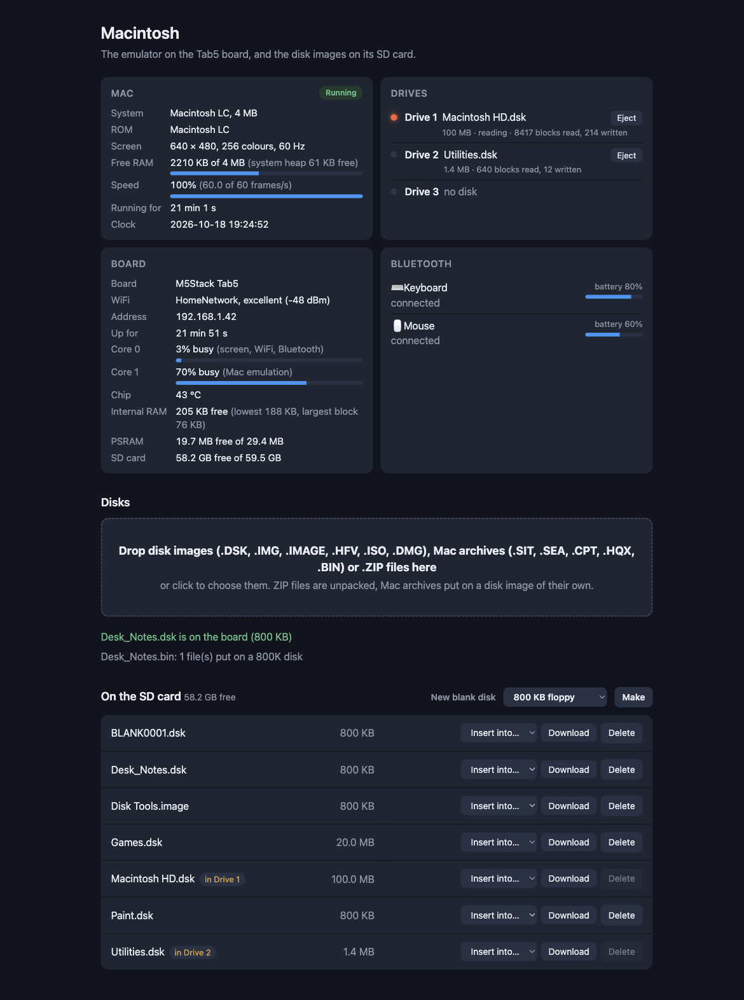
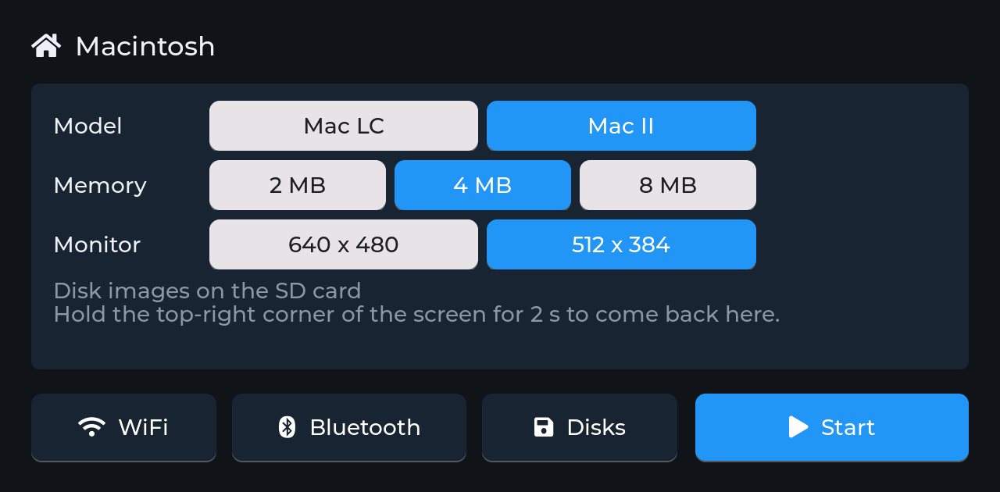
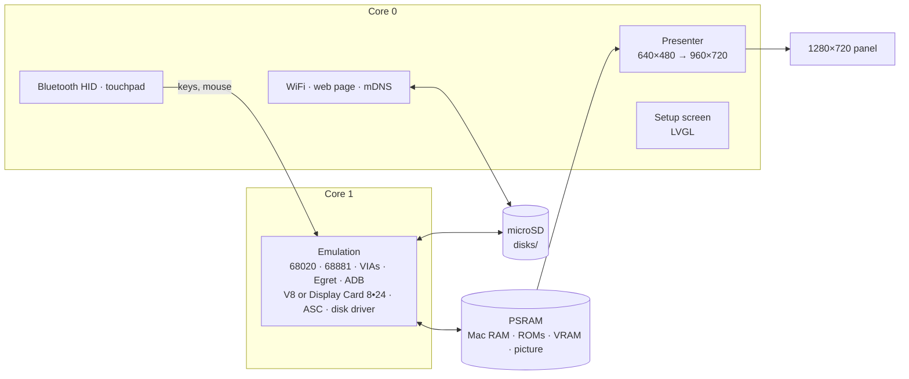

<h1 align="center">esp32mac2</h1>

<p align="center">
  <b>A colour Macintosh LC or Macintosh II on an M5Stack Tab5.</b><br>
  68020 (and the II's 68881), 640×480 in 256 colours, up to 10 MB, System 7.5.5, disk images of any size in three drives, Bluetooth keyboard and mouse, the touch screen as a touchpad.
</p>

<p align="center">
  
  
  
  
  
  
</p>

<p align="center">
  <b>Work in progress:</b> not everything has been tested, and games and demos may or may not
  work satisfactorily.
</p>

<p align="center">
  
  
  <br>
  
  
  <br>
  <sub>System 7.5.5 on the Macintosh LC with 4 MB, and its Jigsaw Puzzle in 256 colours;
  the Macintosh II's Display Card 8•24 with a colour desktop pattern, and the II with 8 MB.
  640×480, from the desktop build of the same emulator (<code>components/mac2/host</code>).</sub>
</p>

esp32mac2 turns an M5Stack Tab5 into a colour Mac, chosen on its setup
screen: the **Macintosh LC**, Apple's first low-cost colour Mac (the V8
chip's built-in video, Egret, the Apple Sound Chip), or the **Macintosh
II**, the first colour Mac (a 68881 floating-point unit, two VIAs, NuBus
with Apple's Display Card 8•24, the original Apple Sound Chip). Both show a
13-inch (640×480) or 12-inch (512×384) monitor, scaled to fill the panel's
height. A Bluetooth keyboard and mouse (or your finger on the screen) work
the Mac, and disk images on the microSD card go into three drives. A setup
screen on the touch panel, and a web page on your network, handle
everything else.

It's the colour sibling of [esp32mac](https://github.com/rlucencic/esp32mac)
(the compact black-and-white Macs: Plus, SE and Classic) and
[esp32mac3](https://github.com/rlucencic/esp32mac3) (the 68030 Macs: LC II
and LC III), next to [esp32ste](https://github.com/rlucencic/esp32ste)
(Atari STE), [esp32cpc](https://github.com/rlucencic/esp32cpc) (Amstrad
CPC), [esp32zx](https://github.com/rlucencic/esp32zx) (ZX Spectrum),
[esp32cbm](https://github.com/rlucencic/esp32cbm) (Commodore 64 and 128),
[esp32xl](https://github.com/rlucencic/esp32xl) (Atari 800XL and 130XE),
[esp32msx](https://github.com/rlucencic/esp32msx) (MSX1 and MSX2),
[esp32gs](https://github.com/rlucencic/esp32gs) (Apple IIGS),
[esp32coco](https://github.com/rlucencic/esp32coco) (Tandy Color Computer 2
and 3),
[esp32pc](https://github.com/rlucencic/esp32pc) (IBM PC/XT and PC/AT) and
[esp32ami](https://github.com/rlucencic/esp32ami) (Amiga 500, 2000 and 600);
all are built on the shared runtime
[esp32emu](https://github.com/rlucencic/esp32emu), which also holds the
68020 core.

## Features

**The machines**
- **68020** at 15.67 MHz ([Musashi](https://github.com/kstenerud/Musashi)
  core), at full speed on the Tab5: the idle Finder keeps core 1 about 70%
  busy on the LC, 64% on the II
- **Macintosh LC**: 2, 4, 6 or 10 MB (the board's 2 MB and a SIMM pair);
  the V8's built-in video at 640×480 in black and white up to 256 colours,
  or 512×384 up to thousands (32,768); Egret for the ADB keyboard and mouse, the
  clock and parameter RAM; the V8's Apple Sound Chip; no FPU, as a stock LC
- **Macintosh II**: 2, 4 or 8 MB; a **68881** FPU; two VIAs (ADB, the clock,
  the slot interrupts); the original Apple Sound Chip with its four-voice
  wavetable (the II's startup chord); NuBus with the **Macintosh Display
  Card 8•24** in slot $9, found and driven by its own ROM (black and white
  up to 256 colours)
- A 13-inch (640×480) or 12-inch (512×384) monitor, chosen on the setup
  screen, whose buttons say how many colours each one gets on the model
  (LC: up to 256 or 32,768; II: up to 256 on both); 256 colours by default
  on both
- The startup chime, system beeps and sound through the Apple Sound Chip,
  on the Tab5's speaker
- The clock is set from the internet; each model's parameter RAM (the
  control panels' settings) is kept across power-offs

**Disks**
- **Three drives** for disk images of any size, floppies and hard disks
  alike, through a fast replacement of the Mac's disk driver (from esp32mac)
- System 7.5.5 tested on both machines; Mac OS 7.6.1 starts on the LC too
  ([esp32mac3](https://github.com/rlucencic/esp32mac3) is made for it)
- Raw images (`.dsk`, `.img`, `.hfv`), Disk Copy 4.2 images (`.image`),
  partitioned hard disk images (`.hda`), CD images (`.iso`, `.toast`,
  locked as CDs are) and uncompressed `.dmg` images (read-only)
- **Mac archives straight from the old download sites**: StuffIt (`.sit`,
  `.sea`), Compact Pro (`.cpt`), BinHex (`.hqx`) and MacBinary (`.bin`)
  files dropped on the web page are unpacked in your browser and put on a
  disk image of their own, ready to insert
- **New blank disks** from the web page (800 KB and 1.4 MB floppies, 20,
  100 or 500 MB hard disks) or the setup screen (800 KB); the Mac offers to
  initialise them
- Disks inserted while the Mac runs appear on the desktop; ejecting one on
  the Mac frees the drive

**Around it**
- **Setup screen** before the Mac starts, and any time while it runs (hold the
  top-right corner for 2 seconds): WiFi, Bluetooth pairing, model, memory,
  monitor, disks, reset
- **Bluetooth keyboard and mouse** (BLE HID), with battery levels
- **The touch screen as a touchpad**, for when there's no mouse at hand
  (a Bluetooth mouse is the better way): drag a finger anywhere to move
  the pointer, tap to click where it points, tap twice to open, tap and
  touch again to drag, hold still half a second to hold the button down
  (the menus)
- **Web page** at `http://macintosh2.local`: drop disk images, Mac archives or
  `.ZIP` files onto it (with a progress bar), put them into drives, eject,
  make blank disks, and watch the Mac (with its free memory), drives, board
  and Bluetooth devices live
- **Sound** on the Tab5's speaker (on by default)

<p align="center">
  
  <br><sub>The web page, right after a MacBinary file was dropped on it and became a disk image (example data)</sub>
</p>

## Hardware

An [M5Stack Tab5](https://docs.m5stack.com/en/core/Tab5):

| | |
|---|---|
| Chip | ESP32-P4 (RISC-V, 360 MHz): 16 MB flash, 32 MB PSRAM; an ESP32-C6 for WiFi and Bluetooth |
| Screen | 5" 1280×720 MIPI-DSI, capacitive touch, held landscape |
| Storage | microSD card (FAT32 or exFAT) |
| Input | any BLE keyboard and mouse, or the Tab5 Keyboard; the touch screen as a touchpad |
| Sound | the built-in speaker (ES8388) |

The Mac's picture is shown at 4:3, 960×720 in the middle of the panel,
smoothly scaled (a pixel of the 640×480 screen is 1.5 of the panel's).

The Makerfabs MaTouch ESP32-S3 7", the other board of the sibling
projects, isn't supported: its ESP32-S3 is too slow for a 68020, and only
2 MB of Mac RAM would fit in its 8 MB of PSRAM.
[esp32mac](https://github.com/rlucencic/esp32mac) is the Mac for that board.

## Getting started

### 1. What you need

- [ESP-IDF](https://github.com/espressif/esp-idf) v5.5 (developed with v5.5.4)
- [esp32emu](https://github.com/rlucencic/esp32emu), checked out next to this project (`../esp32emu`)
- Macintosh ROM images, which are copyrighted and **not included**: dumps of
  your own Mac LC ROM (512 KB) as `roms/lc.rom`; for the Mac II its ROM
  (256 KB, the 800K-floppy version) as `roms/ii.rom` and the Display Card
  8•24's (32 KB) as `roms/mdc824.rom`. They're recognised by their checksums
  (see [roms/README.md](roms/README.md)).
- A microSD card, FAT32 or exFAT, and a disk image with System 7.5.5 (or
  another System 7 that runs on these Macs). Apple gave System 7.5.3 and
  the 7.5.5 update away for free; they're preserved on sites such as
  [Macintosh Garden](https://macintoshgarden.org) and the
  [Internet Archive](https://archive.org).

### 2. Build and flash

```sh
git clone https://github.com/rlucencic/esp32emu.git     # the shared runtime, next to it
git clone https://github.com/rlucencic/esp32mac2.git && cd esp32mac2
idf.py -B build-tab5 -DIDF_TARGET=esp32p4 -DSDKCONFIG=build-tab5/sdkconfig build
idf.py -B build-tab5 -DIDF_TARGET=esp32p4 -DSDKCONFIG=build-tab5/sdkconfig -p /dev/cu.usbmodem… flash   # app and the ROMs
```

Later updates only need `app-flash` instead of `flash`. Instead of flashing
the ROMs, you can also copy them into a `roms` folder on the SD card. The
Tab5 is the only target: a build for any other stops with a message.

### 3. First start

1. The board starts on the **setup screen**. Tap **WiFi** to join your
   network: the clock is set from the internet, and the web page becomes
   reachable.
2. Open `http://macintosh2.local` and drop a system disk image onto the
   page, then choose **Insert into… → Drive 1**.
3. Tap **Bluetooth** to pair a keyboard and mouse (optional: the touch
   screen is a touchpad too).
4. Choose the **model**, **memory** and **monitor**, then tap **Start**: the
   happy Mac, then System 7's desktop in 256 colours.

<p align="center">
  
  <br><sub>The setup screen on the Tab5, with the Mac LC, 4 MB and the 13-inch monitor chosen; under each monitor, its colours on that model (the status lines left out)</sub>
</p>

## Using it

| To | Do |
|---|---|
| Get back to the setup screen | Hold the top-right corner of the screen for 2 s |
| Change the model, memory or monitor | On the setup screen; **Restart** applies it |
| Move the pointer, click | The Bluetooth mouse (any button), or the touch screen as a touchpad: drag a finger anywhere to move the pointer, tap to click, tap and touch again to drag, hold still for half a second to hold the button down (the menus) |
| Insert a disk | Web page: **Insert into…**, or setup screen → **Disks** |
| Eject a disk | Drag it to the Trash on the Mac (frees the drive), or **Eject** on the web page |
| Make a blank disk | Web page: **New blank disk** (choose the size), or setup screen → **Disks** → **New** (800 KB) |
| Copy disk images from a computer | Drop them onto the web page (ZIP files are unpacked) |
| Use a program downloaded as `.sit`, `.cpt`, `.hqx` or `.bin` | Drop the file onto the web page: it becomes a disk image named after it |
| …or from the command line | `curl -T System.dsk http://macintosh2.local/disks/` |

Disk images live in the `disks` folder on the SD card. The inserted disks
are remembered across restarts, and so is each model's parameter RAM.

**Keyboard**: by position, as on Apple's Extended Keyboard (US). Command is
the Windows/⌘ key, Option is Alt, Control is Ctrl; Backspace is Delete,
Delete is the forward delete, Insert is Help, Num Lock is Clear; F1-F15,
Home, End, Page Up and Page Down and the keypad as themselves.

## Configuration

`idf.py menuconfig` → **Emulator board**:

| Option | Default | |
|---|---|---|
| WiFi, setup screen | on | Time zone for the clock (POSIX TZ) |
| Start by itself | off | Countdown on the setup screen |
| Web page, network name | on, `macintosh2` | `http://<name>.local` |
| BLE keyboard and mouse | on | Mouse speed divider |
| Sound on the speaker | on | Volume |

## How it works



- **`components/mac2`**: the LC and the II, platform independent (one file
  for each machine's memory map and wiring, the chips shared). It also
  builds on a desktop (`components/mac2/host`) for testing with scripted
  keyboard and mouse, screenshots, sound recording, CPU and I/O traces.
- **`main`**: the Mac on the board: memory, ROMs, settings, keyboard map,
  mouse and touchpad, drives and status.
- **[esp32emu](https://github.com/rlucencic/esp32emu)**: the board runtime and
  the CPU core, built as a 68020 here (`CONFIG_M68K_68020`), with its FPU on
  for the Mac II (the 68881's transcendental functions through the C library).

Time is counted in CPU cycles at 15.6672 MHz: a "line" of 704 cycles is one
sound sample (22.255 kHz), 370 lines a frame (60.15 Hz). The ROMs are
patched in memory, every patch checked against the expected bytes: no ROM
checksum test, no FPU on the LC (its probe needs a bus error the CPU core
doesn't make), and the `.Sony` floppy driver replaced by esp32mac's small
paravirtual one, which reads and writes disk images block by block: that's
why any image size works, without emulating the floppy controller or SCSI.
Egret is emulated at the level of its packets, with the handshake the LC
ROM itself uses. On the Mac II the Display Card 8•24's own ROM finds the
card in its NuBus slot, sets up its video and draws through it, as on the
real thing. In 24-bit mode the II's address mapping puts the ROM, the
first megabyte of each slot and the I/O where the 24-bit Mac expects them.

## Development

```sh
make -C components/mac2/host                                       # desktop build of the Macs
MAC_DISK1=System.dsk components/mac2/host/build/mac_host roms/lc.rom 3600 lc.ppm 4
MAC_CARD=roms/mdc824.rom MAC_DISK1=System.dsk components/mac2/host/build/mac_host roms/ii.rom 3600 ii.ppm 8

python ../esp32emu/tools/emu_console.py /dev/cu.usbmodem… screenshot screen.png   # the Mac's screen
python ../esp32emu/tools/emu_console.py /dev/cu.usbmodem… send "R 1 8"            # restart as the II with 8 MB
curl http://macintosh2.local/api/status                                          # live status as JSON
```

The host build also takes a script of timed keys, mouse moves and
screenshots (`MAC_SCRIPT`), a parameter RAM file (`MAC_PRAM`) and trace
options. `CLAUDE.md` has the details: the machines' maps and chips, the ROM
patches, debugging options and the lessons learned along the way.

## Limitations

- New. On the Tab5, both machines start System 7.5.5 and run it at full
  speed in 256 colours at 640×480; the pointer and the ADB keyboard
  work. Not tried by hand yet: sound on the speaker, a Bluetooth keyboard
  and mouse, the Tab5 Keyboard. The 12-inch monitor and thousands of
  colours are checked in the desktop build only: both machines start in
  256 colours on either monitor, and the LC's ROM takes thousands at
  512×384 and turns them down at 640×480, as on a real LC.
- The CPU's pace is an estimate: each 68020 cycle is counted twice, for a
  16-bit path to memory; it hasn't been calibrated against a real LC or II.
- No SCSI devices, serial ports, AppleTalk, printer, PDS cards or other
  NuBus cards; no 68851 PMMU on the II, so no virtual memory there. The LC
  has no FPU (as a stock one).
- Millions of colours on the Mac II's card needs 32-bit addressing, which
  the original II only gets with an extension (MODE32); not tried yet.
- Only the Mac II's later ROM (checksum 9779D2C4) is recognised so far.
- The Mac's volume setting is ignored.
- Disk images are presented through the floppy driver: copy-protected
  originals that talk to the floppy hardware directly don't work.

## Credits

- [Musashi](https://github.com/kstenerud/Musashi) by Karl Stenerud (MIT
  licence), via Matt Evans' [fork](https://github.com/evansm7/Musashi) for
  embedded use
- [MAME](https://www.mamedev.org)'s Mac LC and Mac II drivers by R. Belmont
  (V8, pseudo-VIA, Ariel, ASC; hardware tests by Doug Brown) and the
  Display Card 4•8/8•24 by R. Belmont and Vas Crabb, the reference for how
  these machines' chips behave
- Linux's `via-cuda.c` and QEMU's Cuda, for the Egret packets
- [Mini vMac](https://www.gryphel.com/c/minivmac/) and Matt Evans'
  [umac](https://github.com/evansm7/umac), via esp32mac
- [The Unarchiver](https://theunarchiver.com)'s XADMaster by Dag Ågren (LGPL),
  the reference for the StuffIt and Compact Pro formats (via esp32mac)
- [LVGL](https://lvgl.io) for the setup screen
- [ESP-IDF](https://github.com/espressif/esp-idf) and NimBLE

## Licence

[MIT](LICENSE). The Musashi core in esp32emu is MIT licensed too. LVGL (MIT)
and ESP-IDF (Apache 2.0) are fetched at build time and keep their own
licences.

The one exception is `main/web/macfiles.js`, the archive converter for the
web page (from esp32mac): it follows XADMaster closely, so it is under the
[GNU LGPL 2.1](https://www.gnu.org/licenses/old-licenses/lgpl-2.1.html) or
later.

Apple, Macintosh and Mac are trademarks of Apple Inc. This project contains
no Apple code; you need your own ROM images and system software.
